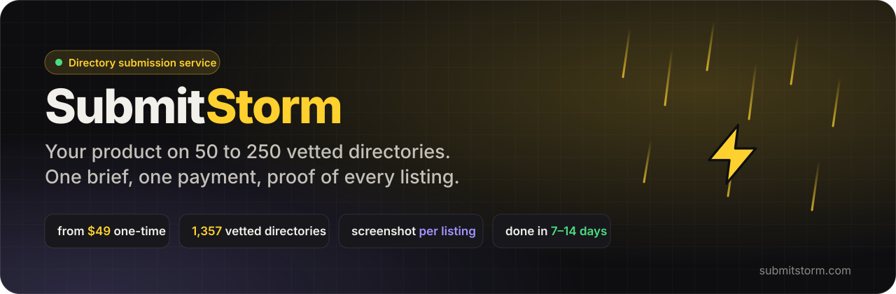
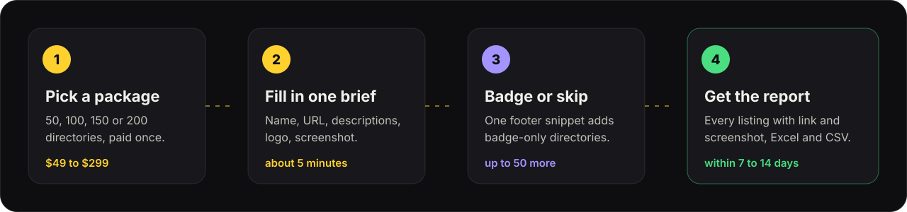

<p align="center">
  <a href="https://submitstorm.com"></a>
</p>

<h1 align="center">SubmitStorm: Directory Submission Service</h1>

<p align="center">
  <b>Done-for-you directory submission for startups, SaaS products and AI tools.<br>
  Pay once, fill in one brief, and get proof of every listing.</b>
</p>

<p align="center">
  <a href="https://submitstorm.com/#pricing"></a>
  <a href="https://submitstorm.com/directories"></a>
  
  
</p>

<p align="center">
  <a href="#what-is-a-directory-submission-service">What it is</a> ·
  <a href="#packages-and-prices">Prices</a> ·
  <a href="#how-it-works">How it works</a> ·
  <a href="#the-directories">Directories</a> ·
  <a href="#faq">FAQ</a> ·
  <a href="https://submitstorm.com"><b>Start at submitstorm.com →</b></a>
</p>

---

> **In one sentence:** [SubmitStorm](https://submitstorm.com) is a directory submission service that lists a startup, SaaS product or AI tool on 50 to 250 vetted web directories for a one-time fee of $49 to $299. Every package comes with a proof screenshot and link for each listing, plus a before-and-after Domain Rating.

## What is a directory submission service?

A **directory submission service** lists your product on web directories for you. These include startup launch platforms, SaaS and AI tool directories and business directories. Each accepted listing is a page about your product on an established site. It usually links back to you, which helps people find you and gives you a **backlink** that SEO tools like Ahrefs count toward your **Domain Rating (DR)**.

Doing it yourself means hundreds of forms, accounts, verification emails and badge rules. A service does all of that from one brief.

| | Do it yourself | With SubmitStorm |
| --- | --- | --- |
| Find directories that are still alive | Hours of research, many dead links | 1,357 checked directories, sorted by Domain Rating |
| Accounts and forms | One per directory | One brief, filled in once |
| Badge rules | Read each site's terms | One footer snippet covers the 50 best badge directories |
| Proof | Your own spreadsheet | Screenshot and link for every listing, as Excel and CSV |
| Cost | Your time: days of forms and inbox checks | $0.98 to $1.50 per directory, once |

## Packages and prices

All prices are in USD and paid once. There is no subscription.

| Package | Price | Directories | With badge component | Extra backlinks | Done within | Queue |
| --- | ---: | ---: | ---: | ---: | --- | --- |
| **Launch** | **$49** | 50 | up to 100 | 10 | 14 days | in order of payment |
| **Growth** ⭐ | **$99** | 100 | up to 150 | 20 | 10 days | in order of payment |
| **Storm** | **$179** | 150 | up to 200 | 30 | 7 days | front of the queue |
| **Hurricane** | **$299** | 200 | up to 250 | 50 | 7 days | front of the queue |

**Every package includes:**

- ✅ Dofollow and high-DR directories first, matched to your product's category
- ✅ A dashboard that counts every submission as it lands
- ✅ A final report with a proof screenshot and link for every listing, as Excel and CSV
- ✅ The badge component: each badge on your site adds a directory, up to 50 more
- ✅ Your Domain Rating recorded when the order starts and when it ends
- ✅ No repeats: a second order for the same site always goes to new directories

👉 **[See the packages on submitstorm.com](https://submitstorm.com/#pricing)** · [pricing as a table](https://submitstorm.com/pricing.md)

## How it works

<p align="center">
  
</p>

1. **Pick a package** and pay once ($49 to $299).
2. **Fill in one brief:** product name, URL, tagline, short and long description, category, logo and one screenshot. It takes about five minutes, or one click with "Fill with AI", which reads your site.
3. **Add the badge component or skip it.** Many good directories list you for free only if their badge is on your site. One snippet in your footer covers the 50 best of them, and each badge adds a directory to your package.
4. **Submissions run within 7 to 14 days**, depending on the package. The final report lists every listing with its link and proof screenshot.

## The directories

The catalog behind SubmitStorm holds **1,357 vetted directories**: launch platforms, startup and SaaS directories, AI tool directories, web directories and niche lists. **302** have a Domain Rating of 50 or more, **670** give a dofollow link and **996** have a free listing. Each one is checked for DR, link type, pricing, badge rules and whether it still accepts submissions.

These are the strongest directories in the catalog by Ahrefs Domain Rating:

| Directory | DR | Type | Link | Pricing |
| --- | ---: | --- | --- | --- |
| [Startup Fame](https://startupfa.me) | 84 | Startup / SaaS | dofollow | Free + paid |
| [Chamber of Commerce](https://chamberofcommerce.com) | 84 | Web directory | dofollow | Free + paid |
| [Fazier](https://fazier.com) | 83 | Launch platform | dofollow | Free + paid |
| [Twelve Tools](https://twelve.tools) | 83 | Startup / SaaS | dofollow | Free + paid |
| [Dang.ai](https://dang.ai) | 82 | AI tools | nofollow | Free + paid |
| [Findly.tools](https://findly.tools) | 81 | Startup / SaaS | dofollow | Free + paid |
| [Turbo0](https://turbo0.com) | 81 | Startup / SaaS | dofollow | Free + paid |
| [SaaSHub](https://saashub.com) | 80 | Startup / SaaS | dofollow | Free + paid |
| [ToolPilot AI](https://toolpilot.ai) | 79 | AI tools | dofollow | Free + paid |
| [BetaList](https://betalist.com) | 77 | Startup / SaaS | dofollow | Paid |
| [There's An AI For That](https://theresanaiforthat.com) | 77 | AI tools | dofollow | Paid |
| [PeerPush](https://peerpush.com) | 76 | Launch platform | dofollow | Free + paid |
| [Uneed](https://uneed.best) | 76 | Launch platform | dofollow | Free + paid |
| [ToolFame](https://toolfame.com) | 76 | Startup / SaaS | dofollow | Free + paid |
| [ShowMeBestAI](https://showmebest.ai) | 76 | AI tools | dofollow | Free + paid |
| [AI Agents Directory](https://aiagentsdirectory.com) | 75 | AI agents | dofollow | Free + paid |

<sub>Domain Rating from Ahrefs, checked October 2026. Browse the lists by type, with screenshots: [AI tool directories](https://submitstorm.com/directories/ai-tools) · [SaaS and startup directories](https://submitstorm.com/directories/saas) · [launch platforms](https://submitstorm.com/directories/launch-platforms) · [high DR directories](https://submitstorm.com/directories/high-dr) · [dofollow directories](https://submitstorm.com/directories/dofollow) · [free directory submission sites](https://submitstorm.com/directories/free).</sub>

## What to expect, honestly

- **Domain Rating:** new sites near DR 0 often reach 20 or more, because dofollow listings on established directories are what Ahrefs counts. Nobody can promise a number, since DR also depends on your other links and on how fast directories approve. That is why SubmitStorm records your DR at the start and at the end.
- **Not every link is dofollow.** Anyone who promises that is wrong. Dofollow directories go first, and the report marks each listing as dofollow or nofollow.
- **Directories review on their own schedule.** Some publish within minutes and others take weeks. The 7 to 14 days is for the submissions themselves.
- **No rankings promised.** Directory listings are a foundation: backlinks, brand mentions and referral visits. They don't replace a good product page.

## FAQ

<details open>
<summary><b>How much does directory submission cost?</b></summary>

SubmitStorm charges once: $49 for 50 directories (Launch), $99 for 100 (Growth), $179 for 150 (Storm) and $299 for 200 (Hurricane). The badge component adds up to 50 more to any package. That works out to $0.98 to $1.50 per directory, or less with badges. Proof screenshots and the report are included.
</details>

<details>
<summary><b>What is the best directory submission service for a startup?</b></summary>

Pick by price per directory, proof and delivery time. A service should show you what it submitted, link by link. It should say plainly that not every link is dofollow and that no one can guarantee a Domain Rating. SubmitStorm gives you a screenshot and link for every listing, a before-and-after DR and a fixed delivery window from $49. For a side-by-side of the services on the market, see **[directory submission services compared](https://github.com/best-directories/directory-submission-services-compared)**.
</details>

<details>
<summary><b>How long does it take?</b></summary>

Submissions are done within 14 days on Launch, 10 on Growth and 7 on Storm and Hurricane, counted from when your brief is complete. Directories then review listings at their own pace.
</details>

<details>
<summary><b>What is the badge component?</b></summary>

Many good directories list you for free only if their badge is on your site. The badge component is one footer snippet covering the 50 best of them, picked for high Domain Rating and mostly dofollow links. Each badge found on your site adds a directory to your package, up to 50. The cap is deliberate, because hundreds of reciprocal links would hurt your SEO.
</details>

<details>
<summary><b>What kinds of products are accepted?</b></summary>

Startups, SaaS, AI tools, mobile apps, developer tools, newsletters, agencies, e-commerce stores and most other legitimate online businesses. Adult content, gambling and anything illegal or deceptive are not accepted.
</details>

<details>
<summary><b>Can I order again for the same site?</b></summary>

Yes. SubmitStorm tracks every directory your site was submitted to and never repeats one, so a second package always means new directories.
</details>

<details>
<summary><b>What if I'm not happy?</b></summary>

You get a full refund if submissions haven't started. Once they're underway the work is done, but if something went wrong on SubmitStorm's side, it gets fixed. See the [refund policy](https://submitstorm.com/refunds).
</details>

## Quick facts

```yaml
name: SubmitStorm
url: https://submitstorm.com
category: Directory submission service
for: startups, SaaS, AI tools, apps, developer tools
pricing: one-time, USD 49 / 99 / 179 / 299
directories_per_order: 50 / 100 / 150 / 200 (+ up to 50 with the badge component)
delivery: 7 to 14 days
proof: screenshot and link per listing, Excel + CSV report
catalog: 1,357 vetted directories (302 at DR 50+, 670 dofollow)
contact: hello@submitstorm.com
```

Machine-readable versions: [`data/packages.json`](data/packages.json) here, and [`/llms.txt`](https://submitstorm.com/llms.txt) on the site.

## Related

- 📊 [Directory submission services compared](https://github.com/best-directories/directory-submission-services-compared): prices, per-directory cost and delivery times across the market
- 📋 [Directory submission sites 2026](https://github.com/best-directories/directory-submission-sites): 50 places to list your product, with DR
- 🚀 [Product Hunt alternatives](https://github.com/best-directories/product-hunt-alternatives): where to launch

---

<p align="center">
  <a href="https://submitstorm.com"><b>⚡ submitstorm.com</b></a> · Make it rain backlinks.<br>
  <sub>This repository is SubmitStorm's own page on GitHub. Text licensed <a href="LICENSE">CC BY 4.0</a>: quote it with a link.</sub>
</p>
